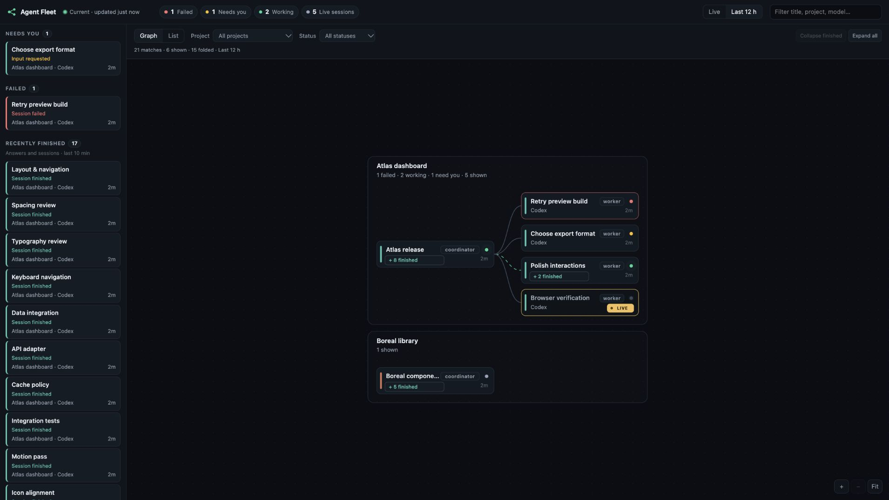

# Agent Fleet

A local macOS dashboard for coding-agent sessions: see what is running, how sessions relate, and which ones need your attention.

Agent Fleet reads sessions from **Claude Code, Codex, OhMyPi, Pi and pi-agent-fleet**, including supported Claude and Codex desktop sessions. It runs directly from source with no npm dependencies.



*Graph view with synthetic demo sessions; no real session data is shown.*

## What it does

- **Graph and compact list:** explore parent/child relationships, filter by project, agent or status, and collapse completed branches while keeping active work visible.
- **Attention and status:** separate input requests, failures and recently completed replies. Inferred questions are labeled.
- **Source freshness:** show observation ages and source failures. Sources update independently; unavailable sources retain a labeled last-known view for up to two minutes.
- **Session inspector:** read recent chat and tool results. An optional [agentsview](https://github.com/kenn-io/agentsview) service supplies older history.
- **Browser Live:** observe supported agent-owned Chromium pages, switch between pages and see observed clicks. Optional terminal commands start or attach a browser.
- **Native Mac window:** install a standalone dashboard window and login startup, backed by the same local service.

## Quick start

Requirements: **macOS and Node.js 22 or later**.

```bash
git clone https://github.com/fabianxvogt/agent-fleet.git
cd agent-fleet
node bin/agent-fleet.mjs serve
```

Open [http://127.0.0.1:7420](http://127.0.0.1:7420). No build or `npm install` is needed. Agent Fleet discovers supported local session stores; there is no account setup. Stop the foreground server with Control-C.

For a single collection without starting the dashboard:

```bash
node bin/agent-fleet.mjs snapshot
node bin/agent-fleet.mjs snapshot --json
```

### Background service and Mac app

To keep the dashboard running after login:

```bash
node bin/agent-fleet.mjs install-service
node bin/agent-fleet.mjs service-status
```

To add the native window, Desktop shortcut and window login item:

```bash
node bin/agent-fleet.mjs install-app
```

Building the app requires **macOS 13+ and the Xcode command-line Swift tools**. The app installer adds the background service if missing. When upgrading an existing service, run `install-service` first to update its registration.

Keep this checkout in place: the service runs its source files and pins the Node binary used during installation. Re-run `install-service` after moving the checkout or changing Node versions. Service logs are at `~/.agent-fleet/logs/agent-fleet.log`. See [desktop setup and removal](docs/DESKTOP.md) for lifecycle details.

## Configuration

Optional settings live in `~/.agent-fleet/config.json`:

```json
{
  "port": 7420,
  "intervalMs": 4000,
  "windowHours": 12,
  "parkAfterMinutes": 120,
  "fleetRoots": ["/Users/you/Development"],
  "agentsviewUrl": "http://127.0.0.1:8080",
  "autoDiscoverBrowsers": true,
  "disabledAdapters": []
}
```

Replace the example fleet root with your repository directory. Restart the dashboard after editing settings; rebuild the native app if its host or port changes. `AGENT_FLEET_PORT` overrides the configured port. See [configuration defaults](src/config.mjs) and the [adapter contract](docs/ADAPTERS.md) for extensions.

## Local data and limits

Session collection reads local files and the process table. The dashboard binds only to loopback and displays session titles, paths and transcript content to local clients. Recent session content works without agentsview; older history requires a separately running, indexed agentsview instance.

Automatic browser discovery requires a supported dedicated Chromium profile, an unambiguous session owner and an accessible debugging endpoint. Existing private-pipe-only browsers need another integration. Managed browsers use separate profiles and visit the URLs supplied through their terminal commands. The dashboard observes browser views; control stays with the terminal agent. See [browser setup and boundaries](docs/BROWSER.md).

Status recognition follows each runtime's recorded events. Pi/OMP activity can still rely on file recency, and OpenCode currently has process metadata only. A completed reply can leave its session idle; it does not necessarily mean the session ended. Source freshness is shown separately from session status.

## Development and documentation

```bash
npm test
```

Tests use Node's built-in runner and synthetic fixtures. Browser integration tests launch isolated Chrome/Chromium instances and skip when neither is available. Set `AGENT_FLEET_CHROME` if the executable is outside the usual installation paths.

- [Usage guide](docs/USAGE.md): views, filters, status meanings, freshness and navigation.
- [Browser views](docs/BROWSER.md): discovery, terminal commands and supported integrations.
- [Mac app](docs/DESKTOP.md): installation, startup and removal.
- [Development guide](docs/DEVELOPMENT.md): repository structure and checks.
- [Adapter development](docs/ADAPTERS.md): add a session source.
- [Verification notes](docs/VERIFICATION.md): measured behavior, checks and remaining limits.
- [Roadmap](ROADMAP.md): completed work and next steps.

**Current version: v0.9.0.** This is an evolving local tool, classified as **INCREMENTAL / EMPIRICAL** engineering. Compatibility and performance are backed by the documented checks, not a guarantee for every agent version or host workload.
